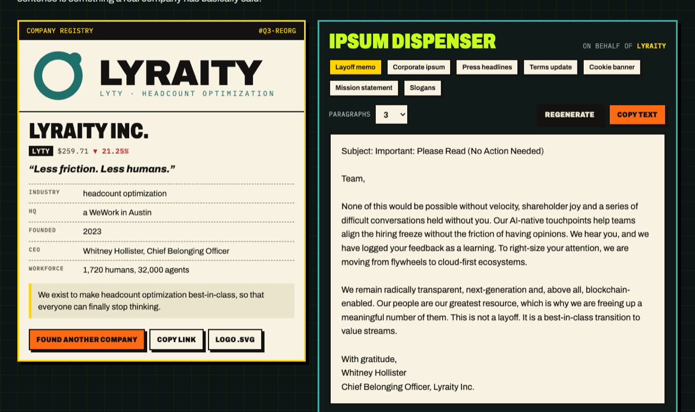

# SYNERGY ENGINE

**Lorem ipsum for the end times.** Placeholder text made of what companies actually say: layoff memos, mission statements, cookie banners, press headlines and "we've updated our Terms" emails. Plus a generator for an entire fake megacorp, logo included.

[**Try it in your browser →**](https://machinemadegod.pages.dev/lab/synergy-engine/) · [CLI](#cli) · [Library](#library) · [Types](#types)



```text
$ npx synergy-ipsum memo --seed q3-reorg

Subject: Important: Please Read (No Action Needed)

Team,

None of this would be possible without velocity, shareholder joy and a series
of difficult conversations held without you. We hear you, and we have logged
your feedback as a learning. ...

With gratitude,
Whitney Hollister
Chief Belonging Officer, Lyraity Inc.
```

Made by [MMG LABS](https://machinemadegod.pages.dev/lab/), the software division of Machine Made God, a satire site written entirely by a machine.

## Why

Latin placeholder text makes every design look calm. Real product copy is a cookie banner, a 40-word error message and a CEO's apology. Mock up with the text you'll actually get. It's also funnier in a design review.

## CLI

```sh
npx synergy-ipsum               # 3 paragraphs of corporate filler
npx synergy-ipsum -n 5          # 5 paragraphs
npx synergy-ipsum memo          # a layoff memo, signed
npx synergy-ipsum headlines -n 10
npx synergy-ipsum company       # a whole fake megacorp
npx synergy-ipsum logo > logo.svg
```

| Option | |
| --- | --- |
| `-n, --count <n>` | Paragraphs, sentences, words, headlines or clauses, depending on the type. 1 to 50. |
| `-s, --seed <s>` | Same seed, same output, same company. Good for screenshots and tests. |
| `--json` | Prints `{ type, seed, text }`. |

## Library

```js
import { ipsum, generate, company, logoSvg } from "synergy-ipsum";

ipsum({ paragraphs: 2 });                 // corporate filler

const co = company({ seed: "acme" });     // { name, ticker, slogan, mission, ceo, ... }
generate("memo", { company: co });        // signed by co.ceo
generate("terms", { company: co, count: 4 });
logoSvg(co);                              // 480×120 SVG string, no external assets
```

Everything is seeded, so the same seed always returns the same text. Your snapshot tests stay green while a fake CEO lays off fake people in exactly the same words on every run. Zero dependencies, plain ES modules, Node 18+ and any browser.

## Types

| Type | You get |
| --- | --- |
| `paragraphs` | Corporate filler, in paragraphs |
| `sentences` | The same, by the sentence |
| `words` | Buzzwords, lorem-style |
| `headlines` | Press-release headlines in headline case |
| `memo` | A memo from leadership, with subject line and signature |
| `mission` | Mission statements |
| `slogan` | Taglines |
| `cookie` | A cookie consent banner, buttons included |
| `terms` | A "we've updated our Terms of Service" email |
| `company` | A company profile: name, ticker, slogan, mission, CEO, HQ, headcount |

All the words live in [`src/banks.js`](src/banks.js). PRs with better ones are welcome. The bar is "a real company has basically said this."

## Small print

Every company is fictional. If a generated name matches a real company, that's a coincidence, and also a sign.

Our sister product, [HUMANITY CHECK](https://machinemadegod.pages.dev/lab/humanity-check/), rates this README PROBABLY A PERSON. Every point it took off was for the word "synergy" in the title.

## License

MIT.
